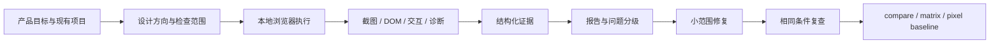

# AestheticFlow

> **让网页设计从主观感觉，变成可复查的浏览器证据。**

面向 AI 编程工具的 Web 视觉审美、交互设计与浏览器审查 Skill，以及配套的本地 TypeScript CLI。

[](https://github.com/violet-05/web-aesthetic-skill/actions/workflows/ci.yml)
[](LICENSE)
[](package.json)
[](SECURITY.md)

**当前版本：0.5.0** · 单引擎报告 schema **1.3** · 矩阵报告 schema **1.1**

---

## 这是什么

AestheticFlow 不是自动给网页打审美分数的 SaaS，也不是“看一眼截图就宣布设计通过”的黑盒模型。

它解决的是另一个问题：

- 设计建议如何对应到具体页面、视口和交互；
- 浏览器检查如何留下真实截图与测量证据；
- `pass / fail / unknown / skipped / error` 如何被严格区分；
- 修复前后如何用相同条件复查；
- 多浏览器和像素回归如何保留边界，而不是伪造“全部通过”。

项目由两层组成：

1. **Agent Skill**：设计方向、视觉审查、交互验证和修复工作流。
2. **本地 CLI**：Playwright 浏览器审查、截图、报告、对比、跨引擎矩阵和像素基线。

默认不上传代码或截图，不调用付费 API，运行在本地。

---

## 核心能力

### 真实浏览器证据

- Playwright Chromium、Firefox、WebKit 单引擎审查。
- 默认桌面、平板、手机三种视口，可自定义尺寸与触屏上下文。
- 真实 PNG 截图、DOM 测量、资源错误、运行时错误和关键元素检查。
- 显式交互场景：`click`、`tap`、`fill`、`press` 与多种结果断言。
- 有界文档滚动、嵌套滚动容器发现、懒加载与部分虚拟列表触发。
- 中止、超时和用户取消会保留已完成证据，未执行项不会被算作通过。

### 可解释的报告

- JSON + 离线 HTML 报告。
- P0–P3 问题分级、证据、修复建议与覆盖率。
- 区分 `measured / heuristic / manual / ai` 来源。
- 同一配置的修复前后对比，未复查的问题不会自动算作已修复。
- 旧版相同 schema 报告仍可比较；规则或检查配置变化会拒绝误判。

### 跨引擎矩阵

```sh
web-aesthetic matrix --url http://127.0.0.1:3000 \
  --browsers chromium,firefox,webkit
```

- 每个引擎保存完整独立报告。
- 根目录生成聚合 `report.html`、`matrix.json`、`metadata.json`。
- 按 `viewport + check id` 对齐检查状态。
- 报告状态差异、失败差异、缺失检查和问题所属引擎。
- 矩阵支持 `completed / partial / timed-out / cancelled / error`。
- 未运行引擎明确标记 `not-run`。

矩阵只比较规则状态，不比较截图像素，也不代表视觉一致。

### 像素基线

```sh
# 建立基线
web-aesthetic review --url http://127.0.0.1:3000 \
  --update-pixel-baseline --pixel-baseline-dir artifacts/pixel-baselines

# 使用相同浏览器、URL、视口和遮罩比较
web-aesthetic review --url http://127.0.0.1:3000 \
  --pixel-baseline --pixel-baseline-dir artifacts/pixel-baselines
```

- 按浏览器、URL、视口、touch、截图范围和遮罩集合隔离基线。
- 支持动态区域 CSS 遮罩、阈值、差异像素占比和 diff PNG。
- 缺失基线、尺寸变化、浏览器版本变化、遮罩缺失或超预算时保持 `unknown`。
- 超阈值只生成 P2 回归证据，**不把像素差解释为审美下降**。

### Agent Skill

- 设计方向必须服务产品定位，而不是套统一模板。
- 视觉、交互、响应式和无障碍按需加载参考与清单。
- 不随机点击未知按钮，不伪报未执行交互。
- 修改范围受用户授权控制；工具本身不自动改目标项目。
- 可安装到 Codex、Cursor 等支持 Skill/规则目录的宿主。

---

## 工作流



完整 Skill 流程见 [SKILL.md](SKILL.md)，CLI 配置和动作语义见 [使用文档](docs/usage.md)。

---

## 快速开始

要求 **Node.js 22+** 和 npm，推荐 Node.js 24 LTS。

```sh
git clone https://github.com/violet-05/web-aesthetic-skill.git
cd web-aesthetic-skill
npm ci
npx playwright install chromium firefox webkit
npm run build
npm run skill-check
```

### 本地演示

启动自带测试服务：

```sh
npm run demo:serve
```

在另一个终端运行：

```sh
# 正常页面
npm run demo:review

# 故意包含缺陷的页面，预期退出码为 1
node dist/cli.js review --config templates/broken-review.json
```

其他可复现实验：

```sh
npm run demo:followup   # 步骤截图、懒加载、总时限
npm run demo:matrix     # 三引擎矩阵
npm run demo:pixel      # 像素基线与动态遮罩
npm run demo:iteration  # 受控修复前后对比
```

报告写入 `artifacts/` 下的独立运行目录，不覆盖已有报告。

---

## CLI

| 命令 | 用途 |
|---|---|
| `inspect-project` | 只读识别项目框架、包管理器和测试入口 |
| `skill-check` | 检查 Skill 元信息、必要文件和本地引用 |
| `review` | 单引擎真实浏览器审查 |
| `matrix` | 同一配置运行多个浏览器引擎并聚合状态差异 |
| `compare` | 对比相同规则配置下的前后报告 |

### 审查现有页面

先按项目说明启动开发服务器，确认真实端口：

```sh
web-aesthetic inspect-project
web-aesthetic review --url http://127.0.0.1:3000
web-aesthetic review --url http://127.0.0.1:3000 --browser firefox
web-aesthetic review --url http://127.0.0.1:3000 \
  --viewports 1440x900,768x1024,390x844 \
  --output artifacts/review
```

推荐从配置模板开始，明确写出关键元素和核心交互，而不是让工具随机点击页面：

- [基础配置](templates/review-config.example.json)
- [完整交互场景](templates/demo-review.json)
- [缺陷页场景](templates/broken-review.json)
- [触屏 tap](templates/touch-review.json)
- [嵌套滚动](templates/nested-scroll-review.json)
- [像素基线与遮罩](templates/pixel-baseline-review.json)

### 修复后复查

```sh
web-aesthetic compare \
  --before artifacts/before/report.json \
  --after artifacts/after/report.json \
  --iteration 1
```

`fixed` 需要后一轮有明确 `pass` 证据；问题消失但检查被跳过、超时或取消时只会进入 `unverified`。

---

## 配置示例

```json
{
  "url": "http://127.0.0.1:3000",
  "browser": "chromium",
  "project": "My product",
  "output": "artifacts/review",
  "viewports": [
    { "name": "desktop", "width": 1440, "height": 900 },
    { "name": "mobile", "width": 390, "height": 844, "touch": true }
  ],
  "requiredElements": [
    { "css": "main" },
    { "role": "heading", "name": "产品标题" }
  ],
  "interactions": [
    {
      "name": "open-menu",
      "priority": "P1",
      "steps": [
        { "action": "tap", "target": { "css": "#menu-toggle" } },
        { "action": "expectVisible", "target": { "css": "#menu" } }
      ]
    }
  ],
  "lazyLoad": {
    "enabled": true,
    "scrollContainers": { "enabled": true, "maxContainers": 8 }
  },
  "pixelBaseline": {
    "enabled": false,
    "mode": "compare",
    "directory": "artifacts/pixel-baselines",
    "maxDiffPixelRatio": 0.005,
    "maxPixels": 20000000,
    "masks": [
      { "selector": "#live-clock", "reason": "实时变化" }
    ]
  }
}
```

未知字段、拼错动作和无效类型会被拒绝。详见 [配置字段](docs/usage.md)。

---

## 证据语义

### 状态

- `pass`：当前规则或断言明确通过。
- `fail`：当前规则或断言明确失败。
- `unknown`：证据不足、需要人工判断或预算耗尽。
- `skipped`：前提失败或未配置，因此没有执行。
- `error`：工具、浏览器或配置执行异常。

### 方法

- `measured`：程序测量或真实浏览器断言。
- `heuristic`：待解释的启发式提示。
- `manual`：需要人工视觉或可用性判断。
- `ai`：预留给未来视觉模型适配器，本版不执行。

### 覆盖率

```text
coverage = (pass + fail) / 全部检查数
```

它是当前检查清单的完成比例，不是页面总体覆盖率、审美分数或 WCAG 合规率。

正常页面通常仍会显示 `incomplete`，因为审美维度需要人工评审，未配置的交互和未加载资源也不能伪报通过。

---

## 报告结构

每次运行创建独立目录：

```text
report-.../
├── report.json
├── report.html
├── metadata.json
├── screenshots/
└── diagnostics/
    ├── console-errors.json
    ├── interaction-results.json
    ├── layout-findings.json
    ├── lazy-load-results.json
    └── pixel-baseline-results.json
```

矩阵运行额外生成：

```text
matrix-.../
├── report.html
├── matrix.json
├── metadata.json
├── chromium/...
├── firefox/...
└── webkit/...
```

---

## 安装 Skill

源码目录构建后：

```sh
npm run build
npm link
web-aesthetic --help

npm run install:skill -- --target codex
npm run install:skill -- --target cursor
```

默认安装到用户级 Skill 目录；`--project` 可指定另一个目标项目。安装器只复制知识库，不安装 CLI、不修改宿主设置，也不会覆盖已有 Skill 目录。

安装与宿主兼容性见 [docs/installation.md](docs/installation.md)。

在支持 Skill 的 AI 工具中可以这样请求：

> 使用 web-aesthetic，为这个页面选择适合产品定位的设计方向，实现后检查手机与桌面的真实页面，执行核心交互，再根据证据修复。

---

## 安全边界

- 默认只允许目标本机 origin；其他 origin 必须精确加入允许列表。
- 内网目标还需要显式 `allowPrivateNetwork`。
- 元数据、链路本地和特殊地址始终拒绝。
- DNS 全结果检查，并通过固定已验证 IP 的本地出口代理降低重绑定风险。
- WebSocket、Service Worker、下载、新窗口和登录态流程受限，会明确标记验证不完整。
- 截图、页面正文和错误文本仍可能包含敏感信息；使用像素基线时还会额外写入稳定截图与 diff 文件。

详见 [SECURITY.md](SECURITY.md)。

---

## 能力边界

本版**没有**实现：

- 视觉模型或自动审美评分；
- 完整 WCAG 审计；
- 真实设备型号、软键盘和复杂手势轨迹模拟；
- 全动画时间线验证；
- 登录态导入；
- 自主代码修复控制器；
- 跨轮像素趋势和矩阵版本历史；
- frame 或所有 transform 驱动虚拟列表的完整遍历。

像素基线只支持回归调查；矩阵只支持单次跨引擎状态汇总。两者都不能替代人工视觉审查。

---

## 项目结构

```text
src/
├── browser/        Playwright、网络策略、截图、滚动预处理
├── checks/         页面规则与交互断言
├── pixel/          PNG 基线、遮罩、diff 与 manifest
├── reports/        报告类型、HTML、compare、矩阵聚合
├── matrix.ts       跨引擎编排
├── reviewer.ts     单引擎审查流水线
└── cli.ts          命令解析与退出码

references/         设计参考
styles/             八种视觉风格
workflows/          Skill 工作流
checklists/         视觉、交互、响应式、无障碍与发布清单
templates/          CLI 配置与演示
tests/              单元、真实浏览器、矩阵、像素与安装包测试
```

架构细节见 [docs/architecture.md](docs/architecture.md)。

---

## 开发与测试

```sh
npm run typecheck
npm run lint
npm run test:unit
npm run test:integration
npm run build
npm run skill-check
npm run validate
npm run test:package
```

集成测试使用真实 Chromium、Firefox 和 WebKit，覆盖：

- 多视口截图与核心交互；
- 故意缺陷检测；
- DNS、重定向与代理边界；
- 懒加载、嵌套滚动、超时与取消；
- 跨引擎矩阵与矩阵超时；
- 像素基线、动态遮罩与 diff；
- CLI 和独立安装包。

首次安装浏览器需要联网；Linux 系统依赖请参考 Playwright 官方说明。项目不会为了运行方便而默认关闭浏览器 sandbox。

---

## 文档与路线图

- [安装](docs/installation.md)
- [使用与配置](docs/usage.md)
- [浏览器审查](docs/browser-review.md)
- [架构](docs/architecture.md)
- [故障排查](docs/troubleshooting.md)
- [路线图](docs/roadmap.md)
- [变更记录](CHANGELOG.md)
- [贡献指南](CONTRIBUTING.md)

计划中的下一步是跨轮像素趋势、矩阵前后对比、frame/transform 虚拟列表覆盖、可替换视觉审查适配器，以及带授权、备份和回滚的受控修复编排。

---

## License

[MIT](LICENSE)

如果这个项目对你有帮助，欢迎提交 Issue、复现用例或 Pull Request。请不要在公开报告中上传含敏感信息的真实页面截图。
